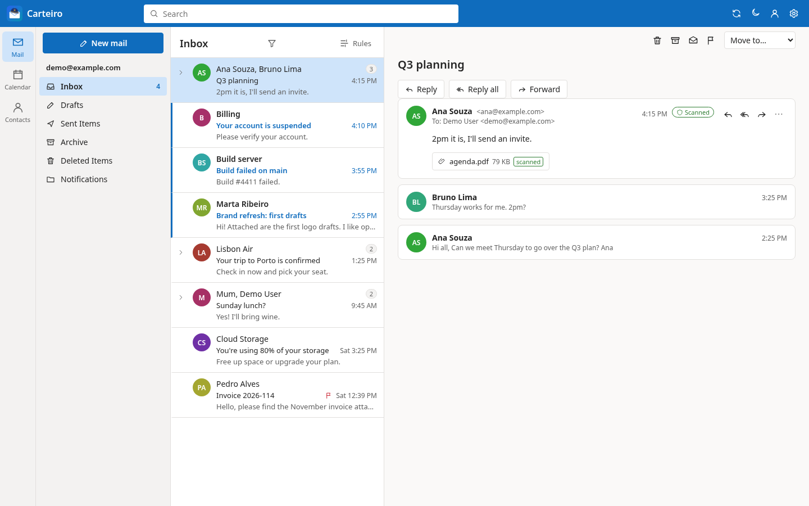
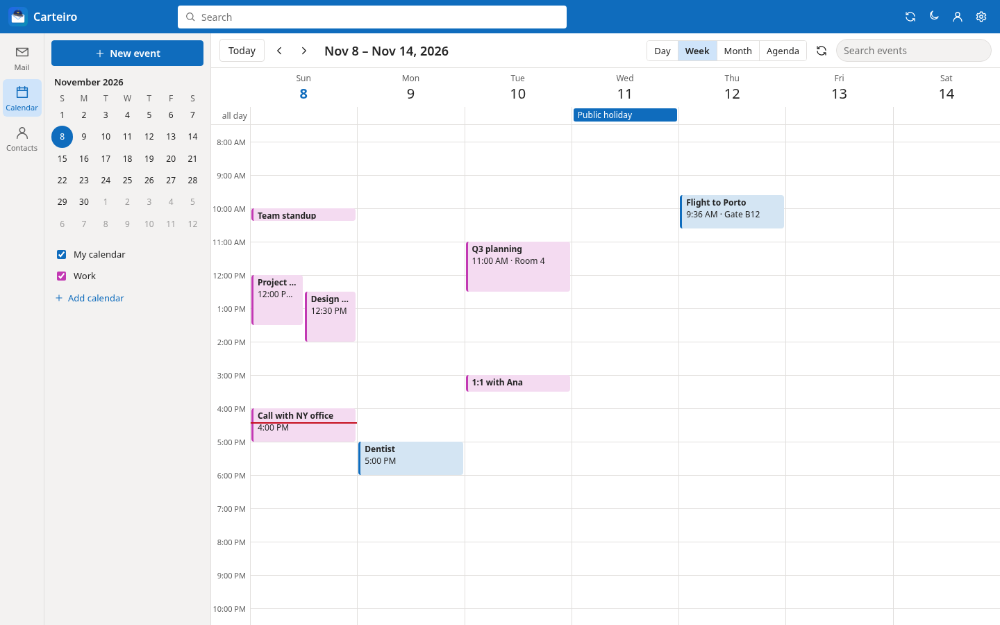
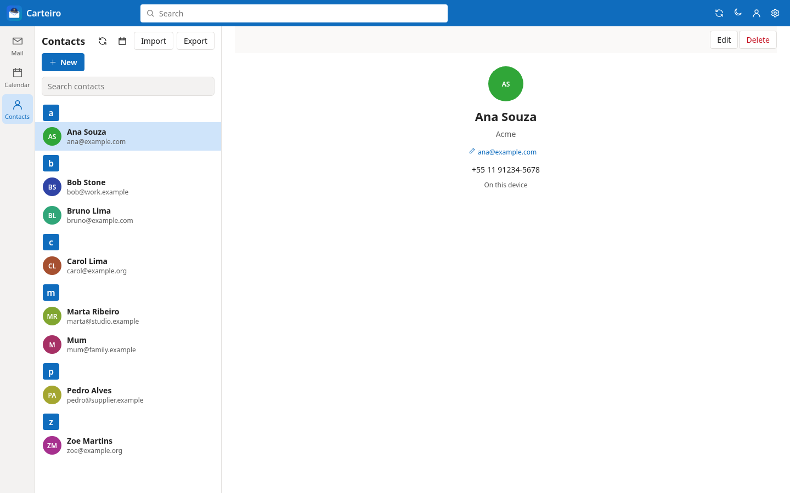
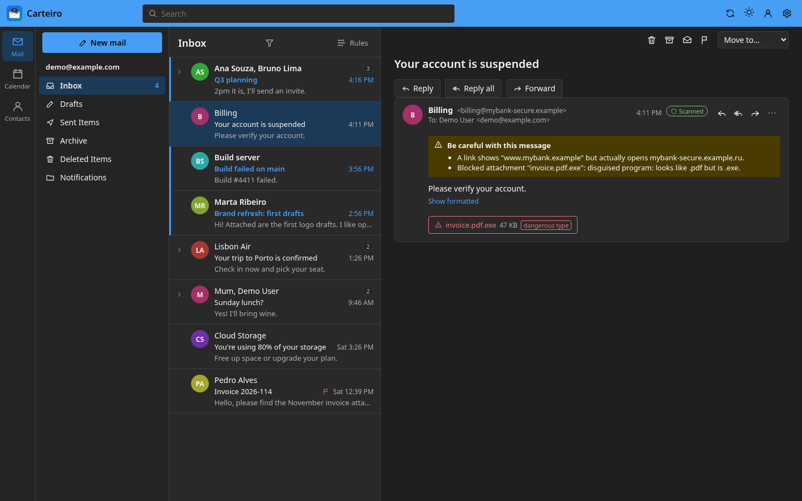
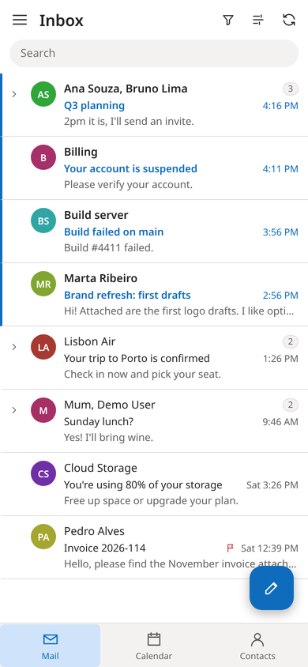
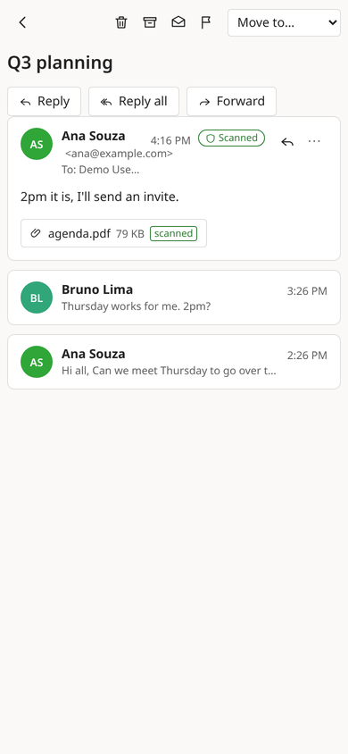
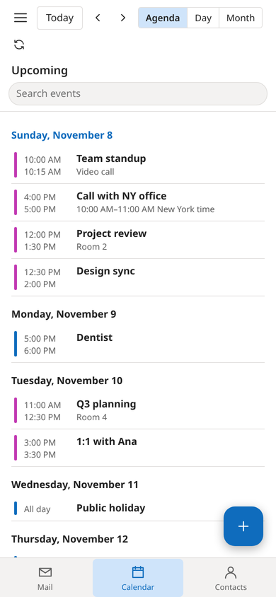
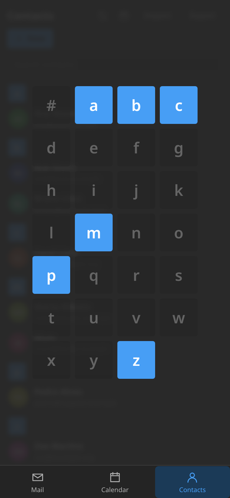

  

<h1 align="center">Carteiro</h1>

<b>Your mail, calendar and contacts in one fast, private app, on Windows, Linux and Android.</b>

  

Carteiro is an email and calendar client with the familiar Outlook layout: folders on the left, conversations in the middle, the message on the right. On a phone it becomes one tidy pane at a time with a bottom bar. It works with any mail provider, keeps working offline, and is built to keep trackers, phishing and malware out of your inbox.

## Why Carteiro

- **Every account in one place.** Gmail, Outlook / Microsoft 365, and any IMAP or POP3 provider, with a unified inbox.
- **Mail, calendar and contacts together.** Google, Microsoft and CalDAV/CardDAV calendars and address books stay in sync; public holidays for 200+ countries are one click away.
- **Private by default.** Remote images and trackers are blocked, tracking parameters are stripped from links, and no script in an email ever runs.
- **Protected from malware and phishing.** A built-in ClamAV engine scans every message and attachment; disguised files and lying links are flagged before you click.
- **Works offline.** Read the last day, month, year or everything without a connection; sending and changes wait in the Outbox until you're back.
- **Yours to keep.** Export mail as `.mbox`, contacts as vCard, and back everything up into one encrypted file you can restore on any device.
- **Light and fast.** A native Rust core with small installers, light and dark themes, and automatic, signed updates.

## Screenshots

| Calendar | Contacts |
|---|---|
|  |  |

**Phishing caught, in dark mode.** The link that pretends to be the bank and the disguised `.exe` are flagged, and the attachment can't be saved.

**On Android:** inbox, a conversation, the agenda, and the contacts letter jump.

  
  
  
  

## Install

Download the latest release from the [Releases page](https://github.com/Gabrielcarvfer/carteiro/releases):

- **Windows:** the `.msi` installer.
- **Linux:** the `.AppImage`; make it executable and run it.
- **Android (9 or newer):** the `.apk`; allow installing from your browser or file manager when Android asks.

Every release is checked by VirusTotal before it's published, and `SHA256SUMS` lists the checksums of all files.

## Learn more

- [User guide](docs/USER-GUIDE.md): accounts, mail, calendar, contacts, backups and settings.
- [Security](SECURITY.md): how Carteiro protects you, and how that was tested.
- [Development](DEVELOPMENT.md): building, testing, sign-in app registrations and releases.

Carteiro is free software under the [GPL-3.0-or-later](LICENSE) license.
